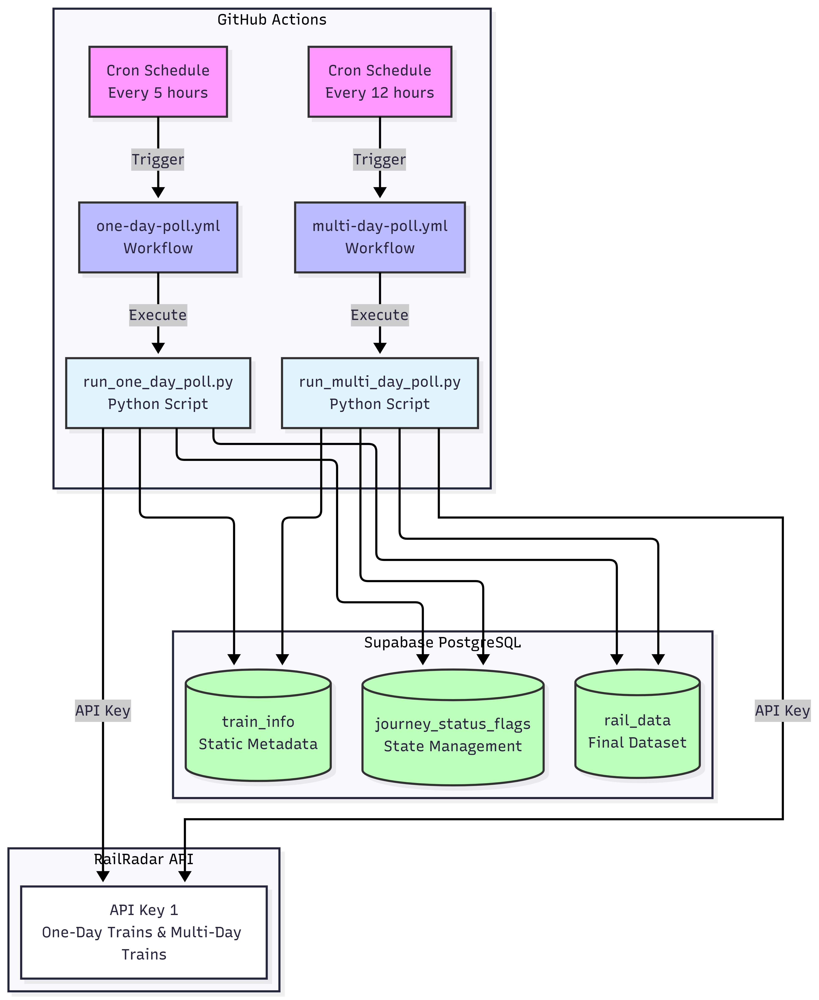
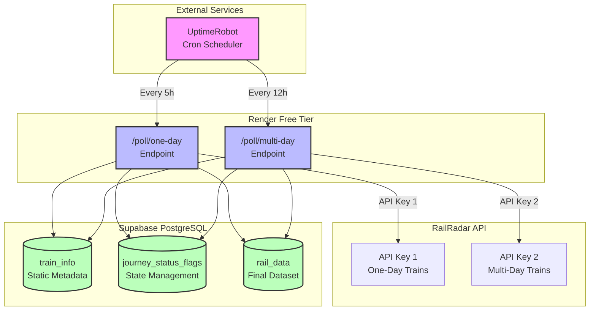
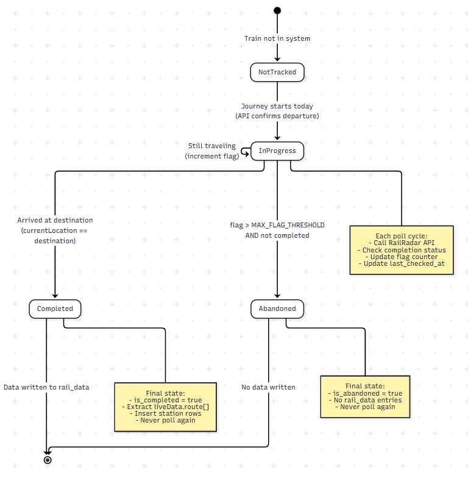
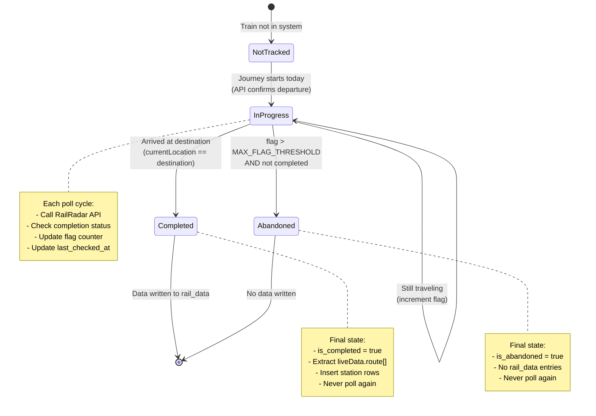
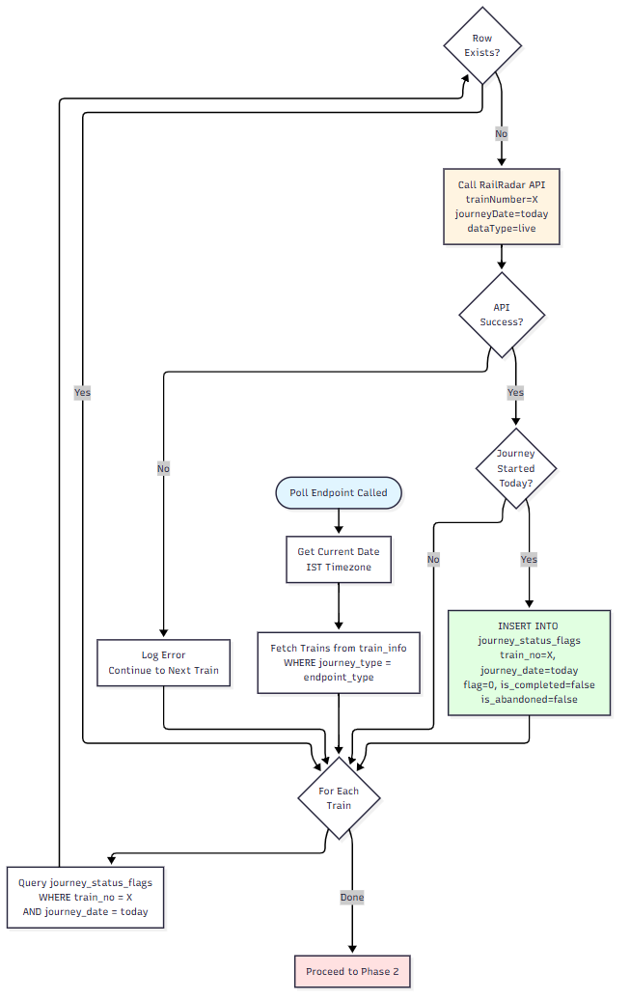
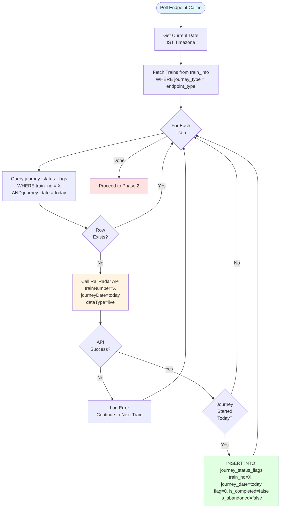
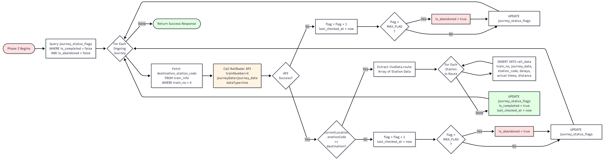
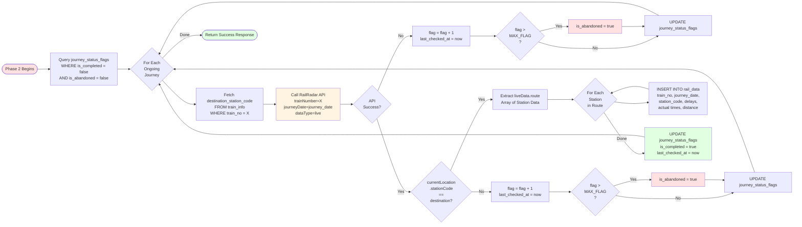
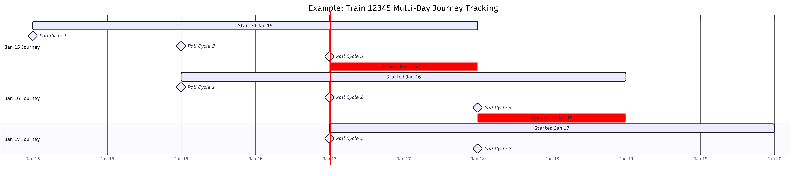
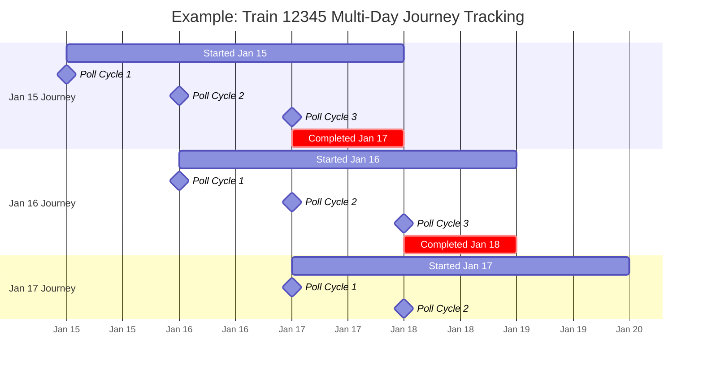

# Rail Data Collection System - Implementation Plan

## Overview

Build a stateless Flask web service deployed on Render that collects Indian Railways delay data by polling RailRadar API and persisting journey lifecycle data in Supabase PostgreSQL.

---

## System Architecture
### Architecture Diagram





---

## Journey State Machine





---

## Dual-Phase Polling Logic

### Phase 1: New Journey Detection





**Logic Details:**

1. **Date Context**: Always use IST (Indian Standard Time) for `today` calculation
2. **Train Filtering**: Only process trains matching `journey_type` (one_day or multiple_day)
3. **Existence Check**: Skip trains that already have a `journey_status_flags` row for today
4. **Journey Validation**: Check RailRadar response for indicators that journey actually started:
   - `liveData` is present
   - `liveData.journeyDate` matches today
   - `liveData.currentLocation` is not null
5. **Initial State**: New journeys start with `flag=0`, both booleans false

---

### Phase 2: Ongoing Journey Tracking





**Logic Details:**

1. **Query Scope**: Only fetch journeys not yet finalized (both flags false)
2. **Completion Detection**: 
   - Parse `liveData.currentLocation.stationCode`
   - Compare with `train_info.destination_station_code`
   - Must be exact string match (case-sensitive)
3. **Station Data Extraction**:
   - Iterate through `liveData.route[]` array
   - Extract: `stationCode`, `scheduledArrival`, `scheduledDeparture`, `actualArrival`, `actualDeparture`, `delayArrivalMinutes`, `delayDepartureMinutes`, `distanceFromOriginKm`
   - Store Unix timestamps as integers
4. **Flag Incrementation**: Happens on both API failure and incomplete journey
5. **Abandonment Logic**: When `flag > MAX_FLAG_THRESHOLD` (default 6) AND journey not completed

---

## Parallel Journey Handling





**Key Points:**

- Same `train_no` can have multiple active journeys simultaneously
- Each journey identified by unique `(train_no, journey_date)` pair
- Phase 1 creates new journeys daily (if train runs daily)
- Phase 2 tracks all ongoing journeys in parallel
- Database queries use composite keys to isolate journeys

**Example Scenario (Jan 17, 2026):**

| train_no | journey_date | flag | is_completed | Status |
|----------|-------------|------|--------------|---------|
| 12345 | 2026-01-15 | 3 | false | Still tracking (multi-day) |
| 12345 | 2026-01-16 | 2 | false | Still tracking (started yesterday) |
| 12345 | 2026-01-17 | 0 | false | Just detected (started today) |

---

## Database Operations

### 1. Read Operations

```sql
-- Phase 1: Check if journey exists
SELECT id FROM journey_status_flags
WHERE train_no = ? AND journey_date = ?;

-- Fetch trains by journey type
SELECT train_no, destination_station_code 
FROM train_info
WHERE journey_type = ?;

-- Phase 2: Get ongoing journeys
SELECT train_no, journey_date, flag 
FROM journey_status_flags
WHERE is_completed = false AND is_abandoned = false;

-- Get destination for completion check
SELECT destination_station_code 
FROM train_info
WHERE train_no = ?;
```

### 2. Write Operations

```sql
-- Phase 1: Create new journey tracker
INSERT INTO journey_status_flags 
(train_no, journey_date, flag, is_completed, is_abandoned, last_checked_at)
VALUES (?, ?, 0, false, false, NOW());

-- Phase 2: Increment flag
UPDATE journey_status_flags
SET flag = flag + 1, last_checked_at = NOW()
WHERE train_no = ? AND journey_date = ?;

-- Phase 2: Mark abandoned
UPDATE journey_status_flags
SET is_abandoned = true, last_checked_at = NOW()
WHERE train_no = ? AND journey_date = ?;

-- Phase 2: Insert station data (completed journey)
INSERT INTO rail_data
(train_no, journey_date, station_code, scheduled_arrival, 
 scheduled_departure, actual_arrival, actual_departure,
 delay_arrival_minutes, delay_departure_minutes, distance_from_origin_km)
VALUES (?, ?, ?, ?, ?, ?, ?, ?, ?, ?);

-- Phase 2: Mark completed
UPDATE journey_status_flags
SET is_completed = true, last_checked_at = NOW()
WHERE train_no = ? AND journey_date = ?;
```

### 3. Data Integrity

```python
# Idempotency safeguard - handle duplicate inserts gracefully
# rail_data table has UNIQUE constraint on (train_no, journey_date, station_code)
# Use INSERT ... ON CONFLICT DO NOTHING or try/except for IntegrityError

# Transaction scope for completed journeys:
# - Insert all station rows (rail_data)
# - Update is_completed flag (journey_status_flags)
# Both operations must succeed or rollback together
```

---

## RailRadar API Integration

### Request Structure

```python
# Base URL
base_url = f"https://railradar.in/api/v1/trains/{train_number}"

# Headers
headers = {
    "Accept": "*/*",
    "api-key": RAILRADAR_API_KEY  # Different key per endpoint
}

# Query Parameters
params = {
    "journeyDate": "YYYY-MM-DD",  # Explicit journey date
    "dataType": "live",            # Minimize payload
    "dataProvider": "railradar"    # Default provider
}

# Timeout
timeout = 10  # seconds
```

### Response Handling

```python
# Success case - Parse liveData
{
    "data": {
        "liveData": {
            "trainNumber": "12345",
            "journeyDate": "2026-01-16",
            "currentLocation": {
                "stationCode": "NDLS",  # For completion check
                "status": "ARRIVED"
            },
            "route": [
                {
                    "sequence": 1,
                    "stationCode": "GHY",
                    "scheduledArrival": None,
                    "scheduledDeparture": 1737000000,
                    "actualArrival": None,
                    "actualDeparture": 1737000300,
                    "delayArrivalMinutes": 0,
                    "delayDepartureMinutes": 5,
                    "distanceFromOriginKm": 0
                },
                # ... more stations
            ]
        }
    }
}

# Error cases to handle:
# 1. HTTP errors (4xx, 5xx) -> Increment flag
# 2. Missing liveData key -> Journey not started yet (Phase 1: skip)
# 3. Timeout -> Increment flag
# 4. JSON decode error -> Increment flag
# 5. Empty route[] -> Increment flag
```

### Journey Validation (Phase 1)

```python
def is_journey_started_today(api_response, expected_date):
    """
    Check if RailRadar confirms journey started on expected date.
    
    Returns:
        bool: True if journey is active for expected_date
    """
    try:
        live_data = api_response.get("data", {}).get("liveData", {})
        
        # Must have liveData section
        if not live_data:
            return False
        
        # Journey date must match expected date
        if live_data.get("journeyDate") != expected_date:
            return False
        
        # Must have current location data
        if not live_data.get("currentLocation"):
            return False
        
        return True
    except (KeyError, AttributeError):
        return False
```

### Completion Detection (Phase 2)

```python
def is_journey_completed(api_response, destination_code):
    """
    Check if train reached destination station.
    
    Returns:
        bool: True if arrived at destination
    """
    try:
        current_station = (
            api_response
            .get("data", {})
            .get("liveData", {})
            .get("currentLocation", {})
            .get("stationCode")
        )
        
        return current_station == destination_code
    except (KeyError, AttributeError):
        return False
```

---

## Error Handling Strategy

### 1. API Call Failures

```python
# Scenarios that increment flag:
# - HTTP timeout (10 seconds)
# - HTTP error codes (4xx, 5xx)
# - Network errors (connection refused, DNS)
# - Invalid JSON response
# - Missing expected data structure

try:
    response = requests.get(url, headers=headers, params=params, timeout=10)
    response.raise_for_status()
    data = response.json()
    
    # Validate data structure
    if "data" not in data or "liveData" not in data["data"]:
        raise ValueError("Invalid API response structure")
    
    return data
    
except (requests.RequestException, ValueError, KeyError) as e:
    logger.error(f"RailRadar API error for train {train_no}: {e}")
    # Increment flag in journey_status_flags
    increment_flag(train_no, journey_date)
    return None
```

### 2. Database Failures

```python
# Supabase operations should fail fast and log
try:
    supabase.table("rail_data").insert(data).execute()
except Exception as e:
    logger.error(f"Database insert failed: {e}")
    # Do NOT increment flag for DB errors
    # These should be investigated separately
    raise  # Propagate to endpoint handler
```

### 3. Partial Journey Data

```python
# If journey is completed but route[] is empty:
# - Log warning
# - Mark as completed anyway (is_completed = true)
# - Do NOT insert any rail_data rows
# - Do NOT set is_abandoned (it technically completed)

if is_completed and not route_data:
    logger.warning(f"Journey completed but no route data: {train_no}, {journey_date}")
    mark_completed_without_data(train_no, journey_date)
```

### 4. Endpoint-Level Error Response

```python
# Return 200 OK even with partial failures
# Include summary of operations

{
    "status": "success",
    "timestamp": "2026-01-16T14:30:00Z",
    "phase1": {
        "trains_checked": 15,
        "new_journeys_detected": 3,
        "api_errors": 1
    },
    "phase2": {
        "journeys_tracked": 8,
        "completed": 2,
        "abandoned": 1,
        "still_ongoing": 5,
        "api_errors": 0
    }
}
```

---

## Configuration

### Environment Variables

```bash
# Supabase
SUPABASE_URL=https://xxxxx.supabase.co
SUPABASE_KEY=eyJhbGciOiJIUzI1NiIsInR5cCI6IkpXVCJ9...

# RailRadar API Keys (one per endpoint)
RAILRADAR_API_KEY_ONE_DAY=rr_xxxxxxxxxxxxxxxxxxxxxxxx
RAILRADAR_API_KEY_MULTI_DAY=rr_yyyyyyyyyyyyyyyyyyyyyyyy

# Polling Configuration
MAX_FLAG_THRESHOLD=6
TIMEZONE=Asia/Kolkata

# Flask
FLASK_ENV=production
FLASK_DEBUG=False
```

### Journey Type Configuration

| Parameter | One-Day Trains | Multi-Day Trains |
|-----------|----------------|------------------|
| Endpoint | `/poll/one-day` | `/poll/multi-day` |
| API Key | `RAILRADAR_API_KEY_ONE_DAY` | `RAILRADAR_API_KEY_MULTI_DAY` |
| Cron Interval | 5 hours | 12 hours |
| `train_info.journey_type` | `'one_day'` | `'multiple_day'` |
| Est. API Calls/Month | ~240 (2 trains × 5 cycles × 24 days) | ~240 (10 trains × 1 cycle × 24 days) |

**Note**: Actual API consumption depends on journey completion rates and abandonment.

---

## Deployment Architecture

### Render Setup

```yaml
# render.yaml
services:
  - type: web
    name: rail-data-one-day
    runtime: python
    buildCommand: pip install -r requirements.txt
    startCommand: gunicorn main:app --bind 0.0.0.0:$PORT
    envVars:
      - key: ENDPOINT_TYPE
        value: one_day
      - key: RAILRADAR_API_KEY
        sync: false  # Secret
      - key: SUPABASE_URL
        sync: false
      - key: SUPABASE_KEY
        sync: false

  - type: web
    name: rail-data-multi-day
    runtime: python
    buildCommand: pip install -r requirements.txt
    startCommand: gunicorn main:app --bind 0.0.0.0:$PORT
    envVars:
      - key: ENDPOINT_TYPE
        value: multiple_day
      - key: RAILRADAR_API_KEY
        sync: false
      - key: SUPABASE_URL
        sync: false
      - key: SUPABASE_KEY
        sync: false
```

### UptimeRobot Configuration

**Monitor 1: One-Day Trains**
- Type: HTTP(S)
- URL: `https://rail-data-one-day.onrender.com/poll/one-day`
- Monitoring Interval: 5 hours (300 minutes)
- Method: GET
- Expected Status: 200

**Monitor 2: Multi-Day Trains**
- Type: HTTP(S)
- URL: `https://rail-data-multi-day.onrender.com/poll/multi-day`
- Monitoring Interval: 12 hours (720 minutes)
- Method: GET
- Expected Status: 200

---

## Data Flow Example

### Scenario: New Multi-Day Journey

**Time: Jan 16, 2026 14:00 IST**

1. **UptimeRobot** triggers `/poll/multi-day`

2. **Phase 1 Execution**:
   ```
   Fetch trains: [12345, 12346, 12347] (journey_type = 'multiple_day')
   
   Train 12345:
   - Check: journey_status_flags for (12345, 2026-01-16) → Not found
   - Call RailRadar: journeyDate=2026-01-16, dataType=live
   - Response: liveData.journeyDate = 2026-01-16 ✓
   - Action: INSERT journey_status_flags (flag=0)
   
   Train 12346:
   - Check: journey_status_flags for (12346, 2026-01-16) → Exists
   - Action: Skip (already tracked)
   
   Train 12347:
   - Check: journey_status_flags for (12347, 2026-01-16) → Not found
   - Call RailRadar: journeyDate=2026-01-16
   - Response: No liveData (train doesn't run on Thursdays)
   - Action: Skip (not started)
   ```

3. **Phase 2 Execution**:
   ```
   Fetch ongoing: [(12345, 2026-01-15, flag=2), (12346, 2026-01-16, flag=0)]
   
   Journey (12345, 2026-01-15):
   - Destination: "NDLS"
   - Call RailRadar: trainNumber=12345, journeyDate=2026-01-15
   - Current station: "HWH" (not destination)
   - Action: flag=3, last_checked_at=now
   
   Journey (12346, 2026-01-16):
   - Destination: "MAS"
   - Call RailRadar: trainNumber=12346, journeyDate=2026-01-16
   - Current station: "MAS" ✓ (COMPLETED!)
   - Extract route: 25 stations
   - INSERT 25 rows into rail_data
   - UPDATE is_completed=true
   ```

4. **Response**:
   ```json
   {
     "status": "success",
     "phase1": {"new_journeys": 1},
     "phase2": {"completed": 1, "still_ongoing": 1}
   }
   ```

---

## Implementation Checklist

### Core Components

- [x] **Flask application setup** (`main.py`)
  - [x] Initialize Flask app
  - [x] Load environment variables
  - [x] Configure logging
  - [x] Health check endpoint `/health`

- [x] **Supabase client wrapper** (`db/supabase_client.py`)
  - [x] Initialize Supabase client
  - [x] Query functions for each table
  - [x] Transaction handling for completed journeys
  - [x] Error handling and retries

- [x] **RailRadar API client** (`api/railradar.py`)
  - [x] Reuse/refactor `utils/termux.py` logic
  - [x] Add journey validation functions
  - [x] Add completion detection functions
  - [x] Timeout and error handling
  - [x] Handle both API response formats (nested liveData and root-level)

- [x] **Business logic modules**
  - [x] `services/phase1_new_journeys.py` - New journey detection
  - [x] `services/phase2_ongoing_journeys.py` - Tracking and completion
  - [x] Route data extraction integrated in phase2

- [x] **Polling endpoints** (`main.py`)
  - [x] `/poll/one-day` - Calls both phases with journey_type='one_day'
  - [x] `/poll/multi-day` - Calls both phases with journey_type='multiple_day'
  - [x] Response formatting

### Configuration Files

- [x] `requirements.txt` - Dependencies (including gunicorn)
- [x] `.env.example` - Template for secrets
- [x] `render.yaml` - Deployment config (dual services)
- [x] `README.md` - Setup and deployment instructions

### Testing & Validation

- [x] Manual test with real train data
- [x] Verify API response format handling
- [x] Test Phase 1 new journey detection
- [x] Test Phase 2 ongoing journey tracking
- [ ] Verify idempotency (call endpoint twice)
- [ ] Test flag incrementation logic
- [ ] Test abandonment threshold
- [ ] Validate parallel journey handling

### Documentation

- [ ] API usage tracking spreadsheet
- [ ] UptimeRobot configuration guide
- [x] Train seeding instructions for Supabase
- [x] Known limitations and selection bias notice

---

## API Usage Estimation

### Assumptions
- 5 one-day trains (average 24h journeys, need ~5 polls each)
- 10 multi-day trains (average 48h journeys, need ~5 polls each)
- 80% journey completion rate (20% abandoned)

### Monthly Breakdown

**One-Day Endpoint (5h interval)**
```
Phase 1: 5 trains × 1 call/day × 30 days = 150 calls
Phase 2: 5 trains × 5 polls/journey × 30 days × 0.8 = 600 calls
Total: ~750 calls/month
```

**Multi-Day Endpoint (12h interval)**
```
Phase 1: 10 trains × 1 call/day × 30 days = 300 calls
Phase 2: 10 trains × 5 polls/journey × 15 days × 0.8 = 600 calls
Total: ~900 calls/month
```

**Risk**: Both endpoints exceed 1000 calls/month limit under high load.

**Mitigation**:
1. Use separate API keys (1000 calls each)
2. Monitor usage via logging
3. Adjust polling intervals if needed
4. Lower MAX_FLAG_THRESHOLD to abandon earlier

---

## Known Limitations & Trade-offs

### 1. Selection Bias
Abandoned journeys (flag > 6) are never recorded in `rail_data`. This means:
- Severely delayed trains are underrepresented
- Dataset skewed toward "successful" journeys
- ML models trained on this data may not predict extreme delays well

**Documentation**: Must be disclosed in ML project methodology.

### 2. Historical Gaps
- No backfill capability for past journeys
- Dataset starts from system deployment date
- Cannot retroactively fix abandoned journeys

### 3. Race Conditions
- If UptimeRobot calls endpoint twice simultaneously: minimal impact (duplicate API calls, but DB prevents duplicate inserts)
- If train completes between polls: captured on next cycle

### 4. API Reliability
- RailRadar API downtime affects data collection
- No retry mechanism within same poll cycle
- Compensated by flag-based tracking across multiple cycles

### 5. Timezone Handling
- All dates must use IST (Asia/Kolkata)
- Server timezone must be explicitly set
- Journey dates are calendar dates in IST, not UTC

---

## Success Metrics

1. **Data Integrity**
   - Zero duplicate rows in `rail_data` for same (train_no, journey_date, station_code)
   - All completed journeys have rail_data entries
   - All abandoned journeys have NO rail_data entries

2. **API Usage**
   - Stay under 1000 calls/month per API key
   - Track actual usage vs estimates

3. **Journey Coverage**
   - >80% of tracked journeys reach completion
   - <20% abandonment rate

4. **System Reliability**
   - Endpoints respond within 30 seconds (Render timeout)
   - No database transaction failures
   - Proper error logging for debugging

---

## Next Steps

1. **Implementation Phase**
   - Build Flask app structure
   - Implement Phase 1 logic
   - Implement Phase 2 logic
   - Add comprehensive logging

2. **Testing Phase**
   - Local testing with Supabase staging
   - Validate with 2-3 real trains
   - Test abandonment logic manually

3. **Deployment Phase**
   - Deploy to Render
   - Configure UptimeRobot monitors
   - Seed train_info table with initial trains

4. **Monitoring Phase**
   - Track API usage daily
   - Monitor abandonment rates
   - Adjust MAX_FLAG_THRESHOLD if needed

---

*Document Version: 1.0*  
*Last Updated: January 16, 2026*
